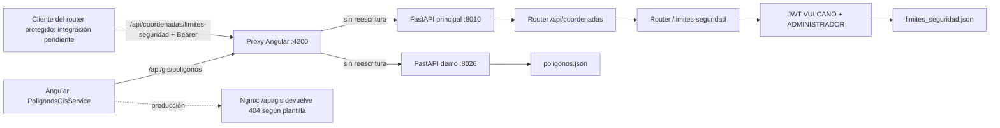

# Revisión y contrato de integración API GIS — VULCANO

Fecha: 28 de octubre de 2026. Alcance: revisión de código y comprobaciones HTTP
locales de lectura. No se modifican Python, autenticación, proxy, modelos,
environments ni servicios Angular. No se ejecutan mutaciones GIS u operativas.

## 1. Resultado de arquitectura

Existen **dos implementaciones distintas**, no dos alias del mismo servicio:

| Implementación | Definición y registro | Ruta interna completa | Autenticación |
|---|---|---|---|
| Límites de seguridad del backend principal | `../back/coordenadas/limites_seguridad.py`; incluido por `coordenadas/coordenadas.py` y después por `../back/main.py` | `/api/coordenadas/limites-seguridad` | JWT VULCANO, access token, rol ADMINISTRADOR |
| Demostración GIS independiente | `demos/gis-polygons/backend/main.py`, `create_app()` y `app = create_app()` | `/api/gis/poligonos` | No declara validación JWT ni autorización |

El router solicitado sí existe: `APIRouter(prefix='/limites-seguridad',
dependencies=[Depends(autorizar_limites)])`. Se anida una sola vez en
`APIRouter(prefix='/api/coordenadas')`; `main.app` incluye ese router, sin
prefijo adicional. **No hay que volver a incluirlo en `main.py`.**

El servicio de demostración no importa ese router ni usa `main.app` del backend.
El lanzador del principal indica Uvicorn `main:app` en puerto 8010; el proxy del
frontend asigna el servicio independiente a 8026. Son procesos y almacenes
diferentes. La ruta del router sin el prefijo padre, `/limites-seguridad`, no
existe en la aplicación principal comprobada.

El archivo real del entorno es `src/environments/environment.shared.ts`,
importado por `environment.ts` y `environment.production.ts`; no se encontró
un archivo llamado `shared-environment.ts`. Ambos entornos heredan
`gisPoligonosUrl: '/api/gis/poligonos'` y `timeout: 30000`.

## 2. Rutas públicas y proxy

| URL del navegador | Proxy Angular de desarrollo | Destino interno | Nginx del repositorio |
|---|---|---|---|
| `/api/gis/poligonos[/{id}]` | `/api/gis/**`, sin reescritura | `127.0.0.1:8026/api/gis/poligonos[/{id}]` | No hay location GIS; `/api/` devuelve 404 |
| `/api/coordenadas/limites-seguridad[/{id}]` | `/api/coordenadas`, sin reescritura | `127.0.0.1:8010/api/coordenadas/limites-seguridad[/{id}]` | No hay location coordenadas; `/api/` devuelve 404 |
| `/api/auth/token` | elimina `/api/auth` | `127.0.0.1:8010/token` | elimina `/api/auth`; destino `AUTH_UPSTREAM` |
| `/api/vulcano/dem/...` | elimina `/api/vulcano` | `127.0.0.1:8010/dem/...` | elimina `/api/vulcano`; destino `DEM_UPSTREAM` |
| `/api/curvas/...` | conserva el prefijo | `127.0.0.1:8010/api/curvas/...` | No hay location curvas; `/api/` devuelve 404 |

Fuentes: `proxy.conf.cjs`, `angular.json` (`@angular/build:dev-server` y
`proxyConfig`), `deploy/default.conf.template`, `Dockerfile`, `compose.yaml`.
Se verificó en ejecución que la regla de desarrollo alcanza la ruta base del
router de límites: no se presume su funcionamiento solo por el patrón.

La plantilla Nginx tiene únicamente excepciones `/api/auth/` y `/api/vulcano/`
antes de `location /api/ { return 404; }`. Compose suministra AUTH_UPSTREAM y
DEM_UPSTREAM, y no declara servicio GIS, puerto 8026 ni variable GIS_UPSTREAM.
El archivo de proxy Angular no se utiliza al servir el build estático en Nginx.

Existe una posibilidad adicional de reescritura, **no utilizada por el cliente
GIS actual**: `/api/vulcano/api/coordenadas/limites-seguridad` elimina
`/api/vulcano` y puede alcanzar la ruta interna protegida. En Nginx esto solo
funcionaría si DEM_UPSTREAM apunta a la aplicación principal completa. No se
probó esa variante ni se propone adoptarla como contrato público sin validarla.



El diagrama describe configuración; no afirma que el proceso 8026 esté activo.

## 3. Inventario HTTP GIS

### Backend principal protegido

Base interna y pública en desarrollo: `/api/coordenadas/limites-seguridad`.
Todos los métodos exigen Bearer ADMINISTRADOR, incluso las consultas.

| Método | Sufijo | Entrada | Éxito y cuerpo |
|---|---|---|---|
| GET | vacío | Ninguna | 200 `ListaLimitesSeguridad`: `{ok:true,total,registros:LimiteSeguridad[]}` |
| POST | vacío | `LimiteSeguridadRequest` | 201 `RespuestaLimiteSeguridad`: `{ok:true,mensaje,registro}` |
| GET | `/{id}` | UUID | 200 `RespuestaLimiteSeguridad` |
| PUT | `/{id}` | UUID + `LimiteSeguridadRequest` completo | 200 `RespuestaLimiteSeguridad`; conserva id/creación y recalcula medidas |
| DELETE | `/{id}` | UUID | 200 `{ok:true,mensaje,id}`; no declara response_model |

Este router **no utiliza ETag, If-Match, campo version ni PATCH**. El bloqueo
de archivo serializa transacciones, pero no detecta una edición obsoleta del
cliente como lo hace el contrato independiente.

### Servicio independiente de demostración

Base interna y pública de desarrollo: `/api/gis/poligonos`.

| Método | Sufijo | Entrada | Éxito |
|---|---|---|---|
| GET | vacío | Ninguna | 200 `Registro[]`, sin sobre |
| POST | vacío | `Entrada` | 201 `Registro`, ETag `"1"` |
| GET | `/{identificador}` | UUID | 200 `Registro`, ETag de versión |
| PUT | `/{identificador}` | UUID + `Entrada` + If-Match obligatorio | 200 `Registro`, versión incrementada y nuevo ETag |
| DELETE | `/{identificador}` | UUID + If-Match obligatorio | 204, sin cuerpo |

Es una demostración sin JWT, no un despliegue equivalente al router protegido.
No debe tratarse su ausencia de autorización como permiso para publicar datos
protegidos ni como solución para evitar los 401 del backend principal.

## 4. Modelos Pydantic del router protegido

Todos heredan `Contrato`: `extra='forbid'`, recorte de espacios y rechazo de
números no finitos. Son modelos Pydantic v2; no declaran modo strict general.

| Modelo/campo | Contrato |
|---|---|
| `LimiteSeguridadRequest.nombre` | Texto de 1 a 100 caracteres después del recorte |
| `descripcion` | Texto o null; por defecto null; máximo 2000 |
| `tipo` | Literal `LIMITE_SEGURIDAD`, valor por defecto |
| `srid` | Literal 4326, valor por defecto |
| `geometria` | `GeometriaPoligono`, obligatorio |
| `estilo` | `EstiloLimiteSeguridad`, por defecto estilo completo |
| `GeometriaPoligono.type` | Literal Polygon, por defecto Polygon |
| `coordinates` | Un único anillo, de 4 a 1001 posiciones incluyendo cierre; cada posición tiene exactamente dos números `[longitud,latitud]` |
| Rango geográfico | Longitud -180..180, latitud -90..90 |
| `EstiloLimiteSeguridad` | `color_relleno='#3498DB'`, `color_linea='#FFFFFF'`, RGB `#RRGGBB`; opacidades 0..1, por defecto 0.65/1; grosor >0 y ≤100, por defecto 2.5 |
| `LimiteSeguridad` | Request + UUID id, `vertices` como pares lon/lat sin cierre duplicado, `sistema_referencia='WGS84'`, `area_m2>0`, `perimetro_m>0` y fechas UTC |
| `RespuestaLimiteSeguridad` | `ok:Literal[True]`, mensaje string, registro `LimiteSeguridad` |
| `ListaLimitesSeguridad` | `ok:Literal[True]`, total int, registros; sin paginación |

Validación geométrica existente: cierre exacto, al menos tres vértices distintos,
sin duplicados interiores, sin autointersección o degeneración; rechaza cada
arista cuyo salto absoluto de longitud sea ≥180°. Shapely valida topología en
lon/lat; PyProj Geod WGS84 obtiene área y perímetro. No hay reparación automática
ni soporte de huecos/MultiPolygon. No se modifican estas reglas.

Ejemplo válido de POST/PUT protegido, sin campos generados por el servidor:

```json
{
  "nombre": "Área de ejemplo",
  "descripcion": "Contrato de integración",
  "tipo": "LIMITE_SEGURIDAD",
  "srid": 4326,
  "geometria": {
    "type": "Polygon",
    "coordinates": [[[-74.1,4.6],[-74.09,4.6],[-74.09,4.61],[-74.1,4.61],[-74.1,4.6]]]
  },
  "estilo": {
    "color_relleno": "#3498DB", "color_linea": "#FFFFFF",
    "opacidad_relleno": 0.65, "opacidad_linea": 1, "grosor_linea": 2.5
  }
}
```

El modelo independiente `Entrada` difiere: nombre máximo 150; descripción string
por defecto vacío; 3..5000 vértices abiertos como `{latitud,longitud}` obligatorios;
geometría Polygon de un anillo exactamente igual a esos vértices en lon/lat más
el cierre. El tipo y el estilo son obligatorios; el estilo usa **camelCase**,
sin defaults y grosor máximo 64. No recibe `tipo`. Rechaza duplicados,
topología inválida y amplitud total de longitudes >180°, una regla distinta de
la comprobación por aristas del router principal. `Registro` agrega UUID,
fechas y version ≥1; no agrega medidas geodésicas ni sistema_referencia.

## 5. Respuestas de error

| Estado | Router protegido | Demo independiente |
|---|---|---|
| 401 | Bearer ausente/inválido, vencido, claims requeridos ausentes o tipo distinto de access; `WWW-Authenticate: Bearer` | No implementado por autenticación |
| 403 | JWT válido con rol distinto de ADMINISTRADOR | No implementado por autorización |
| 404 | UUID válido inexistente: `{"detail":"Límite de seguridad no encontrado"}` | `{"detail":"Poligono no encontrado."}` |
| 409 | FileLock no adquirido en 10 s: `{"detail":"Persistencia ocupada; reintente la solicitud"}` | If-Match diferente del ETag actual: conflicto de versión |
| 422 | UUID, esquema, campos extra, geometría o estilo inválidos | Esquema/UUID/geometría; también falta de If-Match |
| 500 | Acceso, lectura o escritura del JSON fallidos; no sustituye archivo corrupto por lista vacía | `{"detail":"No se pudo acceder al almacen GIS."}` ante ErrorAlmacenamiento |

Los errores explícitos del router protegido usan `{"detail":"mensaje"}`;
los errores de validación FastAPI usan `{"detail":[...]}` con localización,
tipo y mensaje. No depender del texto completo de Pydantic para lógica Angular.
Un UUID mal formado requiere credencial válida para aislar el 422 de posibles
rechazos de autorización. Un método no soportado puede devolver 405; una ruta
no registrada devuelve 404. No confundir errores del proxy (500/502/504 según
implementación y causa) con las respuestas JSON del servicio.

OpenAPI del principal publica la seguridad HTTPBearer, pero **no enumera todos
los 401/403/404/409/500** que producen las funciones. El inventario anterior se
obtiene también del código, no únicamente de OpenAPI.

## 6. Autenticación y compatibilidad Angular

`autorizar_limites` importa `SECRET_KEY` y `ALGORITHM` directamente de
`login.login`. Por tanto, dentro de la aplicación principal usa el mismo
firmante que `/token`: PyJWT HS256, clave `JWT_SECRET_KEY` del entorno privado.
Requiere `sub`, `exp`, `iat`, `jti`, `tipo`, `rol`; `tipo='access'`, sub no vacío
y `rol='ADMINISTRADOR'`. Un refresh token no concede acceso. No usa X-API-Key
como alternativa. Los permisos del catálogo público o recibidos del navegador
no conceden autorización.

**Emisor lógico compartido no equivale a claim `iss` verificado**: login no
emite `iss`/`aud` y el verificador no configura esos parámetros. No hay un
emisor JWT GIS independiente. No se investigaron ni copiaron secretos.

`login/login.py` necesita `JWT_SECRET_KEY`, `LOGIN_TEST_USER` y
`LOGIN_TEST_PASSWORD` al importar; tiempos de access/refresh por defecto
25/60 minutos. El usuario de prueba toma su rol de `LOGIN_TEST_ROL` (default
ADMINISTRADOR). La implementación se declara autenticación temporal de prueba,
no un sistema de autorización de producción completo. El endpoint `/token`
recibe Form username/password y devuelve access_token, refresh_token,
tipo_token, expira_en, usuario y catálogos. Solo se encontró ese endpoint de
autenticación en el router actual; logout/refresh del environment no implican
endpoints registrados.

El cliente actual `PoligonosGisService` es para el servicio independiente:

- Usa `environment.gisPoligonosUrl` y los modelos `PoligonoEntrada/Registro`.
- Activa `SKIP_AUTH_INTERCEPTOR` y `SKIP_ERROR_INTERCEPTOR`; no adjunta el Bearer
  de VULCANO. Convierte errores a mensajes propios y aplica timeout de 30 s.
- Espera lista directa y registro directo, version e If-Match; DELETE sin cuerpo.
- Además, `ApiConfigService.isBackendUrl` no incluye `/api/gis` ni
  `/api/coordenadas` entre sus bases permitidas. Quitar solo SKIP_AUTH tampoco
  garantiza adjuntar credenciales a esas rutas.
- `authInterceptor` limita credenciales a los orígenes y prefijos configurados;
  no se debe ampliar esa lista indiscriminadamente ni enviar tokens a teselas.

**Cambiar únicamente gisPoligonosUrl al router protegido rompería el contrato**:
faltaría Bearer, sobraría vertices en el request, cambiarían nombres de estilo,
sobres, medidas, restricciones y semántica de DELETE/409. Una futura integración
necesita un adaptador explícito de DTO y una decisión acotada sobre publicación
y autenticación del destino autorizado. No se implementa ese cambio en esta
revisión, ni se duplica el router para resolverlo.

## 7. Dependencias y almacenamiento

| Servicio | Dependencias |
|---|---|
| Router protegido | FastAPI, Pydantic v2, PyJWT, Shapely, PyProj, filelock; biblioteca estándar json/pathlib/tempfile/uuid/datetime |
| Adicionales declaradas | `../back/coordenadas/requirements-limites.txt`: shapely ≥2,<3; pyproj ≥3.6,<4; filelock ≥3.13,<4 |
| Login importado | python-dotenv, PyJWT, FastAPI; python-multipart para Form |
| Aplicación principal completa | Además NumPy, Rasterio, Pillow, ReportLab, dependencias de curvas y ESP32; agregar límites no las aísla del inicio de main.app |
| Demo independiente | `requirements.txt`: fastapi ≥0.115,<1; pydantic ≥2,<3; uvicorn ≥0.30,<1; shapely ≥2,<3; httpx ≥0.27,<1 (pruebas) |

Versiones observadas en el intérprete `python` de esta revisión: FastAPI 0.135.3,
Pydantic 2.13.0, PyJWT 2.15.1, filelock 3.32.6, Shapely 2.1.2, PyProj 3.7.2,
HTTPX 0.28.1, Uvicorn 0.44.0, python-dotenv 1.2.2 y python-multipart 0.0.26.
No constituyen un lockfile ni identifican necesariamente el intérprete del
proceso ya iniciado. No se instalaron paquetes.

El principal persiste en `back/coordenadas/data/limites_seguridad.json`, con
FileLock lateral y timeout 10 s, temporal, fsync y reemplazo atómico. La demo
usa `GIS_POLYGONS_FILE` o `demos/gis-polygons/backend/data/poligonos.json`, con
bloqueo propio por hilo/proceso. No son almacenes compartidos ni una migración.

## 8. Separación y posibles interferencias

Inspección de imports y funciones: el módulo límites no importa coordenadas,
DEM, curvas, simulaciones o informes; usa su propio archivo y bloqueo. El router
padre incluye el hijo, pero la dependencia JWT del hijo no se aplica a las
otras rutas del padre. No se encontraron nuevas rutas que colisionen.

La separación es **funcional y de persistencia**, no de proceso: el router
protegido vive en main.app y comparte trabajadores con los otros módulos.
Dependencias ausentes o fallos en su importación pueden impedir iniciar toda
la aplicación; operaciones GIS costosas pueden competir por recursos. Esto
requiere regresión y carga antes de despliegue, sin cambiar cálculos.

Inventario de las demás familias registradas, para comprobar regresión:

| Familia | Rutas internas existentes |
|---|---|
| Coordenadas | POST `/api/coordenadas/registrar`, GET `/api/coordenadas/registros` |
| Simulación/informe | POST `/api/coordenadas/simular-trayectoria`, POST `/api/coordenadas/generar-informe-pdf` |
| Curvas | GET `/api/curvas/health`, `/api/curvas/info`, `/api/curvas/bbox` |
| DEM | GET `/dem/health`, `/dem/info`, `/dem/tilejson.json`, `/dem512/tilejson.json`; GET/POST `/dem/elevacion`; GET `/dem/tiles/{z}/{x}/{y}.png`, `/dem512/tiles/{z}/{x}/{y}.png` |
| Gestión DEM | POST `/dem/cache/clear`, `/dem/warmup`; GET `/dem/cache/info`, `/dem/performance` |
| Diagnóstico DEM | GET `/dem/debug/tile/{z}/{x}/{y}`, `/dem/debug/png/{z}/{x}/{y}`, `/dem/debug/png-pixel/{z}/{x}/{y}`, `/dem/debug/compare`, `/dem/debug/terrarium/{elevacion}`, `/dem/debug/georef` |
| General | GET `/`, `/health`; documentación FastAPI `/openapi.json`, `/docs`, `/redoc` |
| ESP32 | GET/POST `/api/esp32/estado`, WebSocket `/api/esp32/ws` |

Las rutas de gestión no se ejecutaron para esta revisión. Publicar GIS no debe
implicar publicar o cambiar estas familias. La demo local-points en 8025 es
otro servicio y tampoco se modifica.

## 9. Inconsistencias y preparación de integración

| Hallazgo | Consecuencia / siguiente trabajo necesario |
|---|---|
| Environment GIS apunta a demo, no al router protegido | Definir explícitamente qué servicio consume cada pantalla; no equiparar contratos |
| Puerto 8026 no accesible localmente durante la revisión | La URL pública GIS de desarrollo no funciona aunque la regla de proxy exista |
| Nginx no publica `/api/gis` ni `/api/coordenadas` directamente | Preparar y revisar una regla específica al destino elegido; conservar headers Authorization/If-Match y rutas internas correctas |
| Servicio demo sin JWT | No usarlo como sustituto del router protegido ni exponerlo con datos protegidos bajo la expectativa de autorización VULCANO |
| Cliente GIS omite auth y espera otro DTO | Preparar adaptador y política de envío Bearer al único destino autorizado; conservar control de roles backend |
| JWT sin iss/aud explícitos | Documentar la confianza actual por clave/algoritmo/claims, sin afirmar validación de emisor por claim |
| PUT protegido sin versión de cliente | No interpretar 409 como edición obsoleta: aquí significa bloqueo ocupado |
| Documentación histórica contradice código reciente de login | Usar fuentes actuales y OpenAPI vigente; no asumir ausencia de JWT por reportes anteriores |
| Modelos geográficos no equivalentes | No trasladar datos entre almacenes automáticamente; adaptar forma sin alterar las validaciones existentes |

Orden propuesto para un cambio posterior: seleccionar contrato protegido o demo
según el caso de uso; acordar ruta pública y proxy; verificar auth hacia ese
destino; implementar adaptación de cliente; comprobar publicación y regresión.
No se añade un tercer endpoint ni se mueve el router protegido de aplicación.

## 10. Evidencia ejecutada y pruebas pendientes

Se realizó análisis AST de decoradores/rutas y revisión de include_router,
dependencias, interceptores y proxies. Las búsquedas incluyeron el backend
vecino `D:/2026/VULCANO/back`; un directorio histórico de temporales de
validación devolvió acceso denegado, sin impedir leer los archivos vigentes.

Comprobaciones HTTP locales, sin credenciales reales ni escrituras:

| Petición | Resultado observado |
|---|---|
| GET `8010/openapi.json` | Aplicación Servidor VULCANO; aparecen las dos rutas GIS protegidas, cinco operaciones y HTTPBearer |
| GET `8010/api/coordenadas/limites-seguridad` sin token | 401 JSON, WWW-Authenticate Bearer |
| Mismo GET con Bearer deliberadamente inválido | 401 JSON, WWW-Authenticate Bearer |
| GET `8010/limites-seguridad` | 404 JSON |
| GET `8010/api/gis/poligonos` | 404 JSON |
| GET `4200/api/coordenadas/limites-seguridad` sin token | 401 JSON, WWW-Authenticate Bearer: proxy de desarrollo alcanza el servicio protegido |
| GET `4200/api/gis/poligonos` | 500 text/plain del recorrido de proxy; no una respuesta JSON del contrato GIS |
| GET `8026/openapi.json` | Conexión rechazada; no se verificó una instancia independiente activa |

No se probó Nginx en ejecución, login real, 200 autenticado, CRUD, persistencia
o carga. Las siguientes pruebas son necesarias antes de dar por integrada la API:

1. **Publicación:** comparar paths de OpenAPI con el inventario; confirmar que
   el proxy conserva el prefijo elegido y no redirige al index.html; comprobar
   GET/POST/PUT/DELETE y UUID por el mismo origen público en staging.
2. **Autorización:** probar las cinco operaciones sin token, token manipulado,
   expirado, refresh y claims incompletos →401; access OPERADOR →403; access
   ADMINISTRADOR emitido por login vigente →éxito. No desactivar Depends ni usar
   permisos recibidos del cliente como sustituto. No registrar tokens.
3. **Contrato:** POST de ejemplo →201 y sobre correcto; lista →200/total;
   consulta →200; PUT conserva UUID/creación y actualiza geometría/fechas;
   DELETE →200 JSON en principal; consulta posterior →404. Usar almacenamiento
   temporal y restaurar configuración para no tocar datos operativos.
4. **Validación:** UUID inválido, campos extra, vertices de entrada en contrato
   protegido, SRID distinto, orden lon/lat, cierre, duplicados, rangos,
   autointersección, antimeridiano, huecos, tamaños y estilo →422.
5. **Persistencia:** corrupción, falta de permisos y fallo de escritura →500
   sin pérdida de archivo; contención de lock →409; concurrencia y reinicio
   conservan todos los registros y no tocan coordenadas.json.
6. **Demo, si continúa utilizándose:** iniciar en loopback 8026 con archivo
   temporal; probar ETag/If-Match, ausencia de header →422, obsolescencia →409,
   DELETE →204. Son pruebas de otro contrato, no del router protegido.
7. **Angular:** verificar mapeo camelCase↔snake_case, sobres/lista, fechas,
   UUID, medidas, DELETE y mensajes; adjuntar Bearer solo al destino validado;
   manejar 401/403 sin introducir una renovación no implementada. Revisar CORS
   solo si se decide acceso cross-origin; el proxy mismo-origen lo evita.
8. **Regresión:** ejecutar pruebas existentes de coordenadas, DEM, curvas,
   simulación e informes con datos de prueba; verificar que la captura visual
   no llama al CRUD GIS ni registra vértices por sí sola. Medir competencia de
   recursos bajo carga GIS y evitar ejecutar warmup/clear en producción.
9. **Producción:** validar plantilla final con `nginx -t`, upstreams y red
   Docker; comprobar que la ruta pública conserva códigos/cuerpos/headers de
   FastAPI. No asumir que el proxy de desarrollo publica rutas de producción.

Pruebas existentes para reutilizar, **no ejecutadas en esta tarea**:
`../back/test_limites_seguridad.py` (CRUD, auth, geometría, corrupción, reinicio,
concurrencia y aislamiento de coordenadas), `demos/gis-polygons/backend/test_main.py`,
`test_restart.py` y `src/app/shared/gis-polygons/poligonos-gis.service.spec.ts`.
El test principal crea temporales dentro de back: ejecutarlo únicamente en un
entorno de pruebas autorizado, no sobre archivos de datos vigentes.

Ejemplos de comprobación de publicación sin escribir datos:

```powershell
# Sin token debe devolver 401, no 200 HTML ni 404 del proxy.
curl.exe -i http://127.0.0.1:8010/api/coordenadas/limites-seguridad
curl.exe -i http://127.0.0.1:4200/api/coordenadas/limites-seguridad
# Debe alcanzar el servicio demo solo si se inicia expresamente en 8026.
curl.exe -i http://127.0.0.1:4200/api/gis/poligonos
```

## 11. Fuentes de verdad revisadas

- Backend vecino: `main.py`, `coordenadas/coordenadas.py`,
  `coordenadas/limites_seguridad.py`, `coordenadas/requirements-limites.txt`,
  `login/login.py`, `test_limites_seguridad.py`, `lanzador.txt`.
- Repositorio Angular: `src/environments/environment.shared.ts`,
  `environment.ts`, `environment.production.ts`, `angular.json`,
  `proxy.conf.cjs`, `deploy/default.conf.template`, `Dockerfile`, `compose.yaml`.
- Cliente GIS: `src/app/shared/gis-polygons/poligono.model.ts`,
  `poligonos-gis.service.ts`, su spec; `core/services/api-config.service.ts`,
  `core/interceptors/auth.interceptor.ts` y `core/auth/auth-http-context.ts`.
- Demo: `demos/gis-polygons/backend/main.py`, `requirements.txt` y tests.
- Contraste documental: `INTEGRACION_GIS_POLIGONOS.md` y
  `docs/simplificacion-editor-poligonos.md`; la ventana de límites actual no
  equivale al cliente CRUD independiente documentado históricamente.

El resultado es un contrato verificado y un plan de integración pendiente,
no una afirmación de despliegue GIS autenticado completo.
