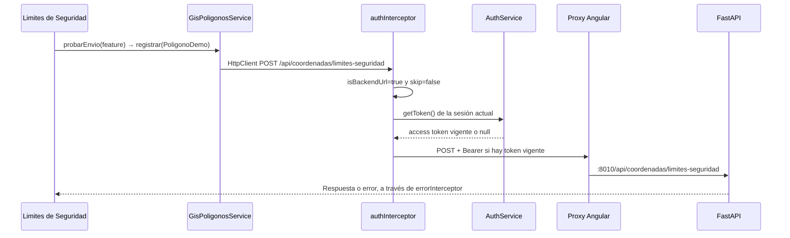

# Auditoría JWT del registro GIS — VULCANO

Fecha: 28 de octubre de 2026. Se revisó el código actual, que ya configura
`gisPoligonosUrl='/api/coordenadas/limites-seguridad'`. Esta configuración es
posterior al [inventario API GIS](contrato-api-gis-vulcano.md), que describía
el destino independiente `/api/gis/poligonos`.

## A. Diagnóstico

**Falla confirmada del frontend:** antes de esta corrección,
`ApiConfigService.getBackendBases()` no incluía el router protegido GIS.
`matchesBaseUrl()` exigía coincidencia de origen y límite de prefijo: las bases
`/api/auth` y `/api/vulcano` no incluyen `/api/coordenadas/limites-seguridad`.
La comparación era correcta; faltaba autorizar este destino específico.

`authInterceptor` evaluaba ese resultado false y devolvía `next(req)` antes
de consultar `AuthService.getToken()` y antes de adjuntar Authorization.
Por tanto, aun con una sesión local vigente, el POST generado por
`GisPoligonosService.registrar()` salía sin Bearer. Su contexto no activaba
SKIP_AUTH_INTERCEPTOR. También quedaba fuera del manejo de 401 protegido de
`errorInterceptor` por el mismo reconocimiento fallido.

Evidencia automatizada: `src/app/core/auth/gis-auth.spec.ts` reinstala mediante
spy la lista anterior de bases, establece una sesión con el contrato de login
simulado y ejecuta el servicio real con los interceptores de `appConfig`.
Comprueba `isBackendUrl=false`, skip=false y ausencia de Authorization; una
respuesta simulada 401 propaga el rechazo. Con la configuración corregida,
la misma cadena adjunta el access token actual y conserva el DTO esperado.

El POST real reportado por el usuario no se volvió a ejecutar: **todas las
pruebas HTTP de esta auditoría usan HttpTestingController**, sin solicitudes
reales ni persistencia. No se inspeccionó la sesión privada del navegador.
La omisión del header está demostrada por código y reproducción controlada;
no se afirma haber validado la firma del JWT real ni reproducido el backend
productivo. Un 401 con Bearer presente necesita investigación adicional del
backend y de la sesión concreta.

Se encontró una segunda falla, independiente de autenticación: el servicio
enviaba `{nombre,descripcion,geometry}`, pero `LimiteSeguridadRequest` exige
`geometria` y rechaza campos extra. Ese request podía producir 422 una vez
superado el rechazo de autenticación. Se adaptó únicamente el nombre del campo
en el DTO HTTP; el anillo de coordenadas se mantiene idéntico.

## B. Flujo de autenticación



### Configuración y registro

- Componente: `ventana-limites-seguridad.ts`, `graficarPoligono()` llama a
  `probarEnvio()`; este usa `GisPoligonosService.registrar()`. Esta auditoría no
  cambia cuándo se invoca, el dibujo ni las acciones del componente.
- `src/app/shared/services/gis-poligonos.service.ts` usa HttpClient; no usa
  fetch, no construye Authorization y no omite los interceptores de auth/error.
- `app.config.ts` registra `provideHttpClient(withInterceptors([
  loaderInterceptor, authInterceptor, errorInterceptor]))`. La nueva prueba usa
  esos providers reales y sustituye únicamente el backend HTTP.
- LoaderInterceptor gestiona el loader; no quita ni sobrescribe Authorization.
  ErrorInterceptor propaga errores y aplica el cierre local existente ante
  401 protegido de la sesión actual; conserva sesión ante 403 y 422.
- No se encontró otro interceptor de producción que elimine el header ni
  otro provideHttpClient que sustituya la cadena en esta ruta.
- `proxy.conf.cjs` envía `/api/coordenadas` a `127.0.0.1:8010`, sin reescribir
  el prefijo. No se cambió el proxy ni la URL. La publicación Nginx sigue siendo
  una cuestión aparte documentada en el inventario anterior.
- No existe `environment.development.ts`; `environment.ts` y
  `environment.production.ts` importan `environment.shared.ts`.

### Sesión, expiración y logout

- `getToken()` devuelve únicamente `accessToken`; no usa refreshToken.
- `isAuthenticated()` compara Date.now() con expiresAt, calculado desde
  expira_en del login. Al vencer limpia la sesión; el interceptor no envía el
  token expirado según ese reloj local. No es validación de firma ni de claims.
- Los tokens están exclusivamente en memoria. El constructor limpia estado
  legado: recargar la página o abrir otra pestaña requiere iniciar sesión.
- No hay renovación automática implementada: refreshToken está reservado en
  memoria. Las URLs refresh/logout del entorno no son una implementación de
  esos mecanismos. Se conserva el comportamiento actual sin agregar refresh.
- Logout limpia access/refresh, expiración, usuario, catálogos y claves propias
  antiguas. Invalida generaciones para que una respuesta tardía de una sesión
  previa no repueble datos ni cierre una sesión nueva ante un 401 viejo.
- La prueba GIS verifica el token de la sesión nueva y un 401 tardío de la
  anterior. También se ejecutan las regresiones existentes de login y logout.

### Diagnóstico temporal seguro

Se agrega `GIS_AUTH_DIAGNOSTIC`, HttpContextToken opt-in por defecto false.
`registrar()` lo habilita solo en desarrollo; el interceptor además bloquea
su ejecución en producción y lo limita a este router del mismo origen.
Para retirarlo basta eliminar la opción de contexto en el servicio o fijarla
a false; no participa en las decisiones de autorización.

La única salida nueva es `console.debug('[GIS AUTH]', snapshot)` con seis campos:

```json
{
  "url": "http://localhost:4200/api/coordenadas/limites-seguridad",
  "backendReconocido": true,
  "interceptorOmitido": false,
  "tokenPresente": true,
  "authorizationAdjuntada": true,
  "estadoSesion": "vigente-local"
}
```

URL sin query, fragmento o credenciales. El estado se obtiene por lectura de
signals: ausente, vencida, cerrando o vigente-local. tokenPresente describe
el access token en memoria antes del manejo normal de expiración; una sesión
vencida puede mostrar tokenPresente=true y authorizationAdjuntada=false.
El diagnóstico no llama adicionalmente a getToken/isAuthenticated, no hace
HTTP, no decodifica JWT ni imprime access/refresh/API Key, headers o cuerpos.
Las URLs inválidas no hacen que el diagnóstico lance errores. Se retiró el log
genérico previo de ApiConfigService, que mostraba URLs sin sanitizar.

### Distinguir causas si persiste 401

| Evidencia | Interpretación / siguiente comprobación |
|---|---|
| backendReconocido=false | URL fuera del destino autorizado; revisar origen y ruta, sin ampliar credenciales a externos |
| interceptorOmitido=true | Revisar HttpContext del llamador; el servicio corregido no activa skip |
| tokenPresente=false | No hay access token local: revisar login previo o recarga/logout |
| estadoSesion=vencida | Expiración local; requiere login, no hay refresh automático |
| authorizationAdjuntada=false con token presente | Revisar skip/reconocimiento y expiración; el nuevo test cubre estos casos |
| Sin snapshot en desarrollo al usar registrar | Revisar nivel debug de consola, contexto y registro de interceptores; en producción el silencio es esperado |
| authorizationAdjuntada=true y backend devuelve 401 | Firma/clave, vencimiento JWT, tipo o claims; el header presente no demuestra validez criptográfica |
| 403 con Bearer válido | Rol distinto de ADMINISTRADOR; no es un 401 ni un problema de geometría |
| 422 | Esquema/UUID/geometría; examinar error.detail, separado de autenticación |

El backend actual importa clave y algoritmo desde login.login, requiere JWT
HS256 con sub/exp/iat/jti/tipo/rol, tipo access, sub no vacío y rol ADMINISTRADOR.
Los rechazos de token producen 401 con detail `Token de acceso inválido o ausente`;
un rol distinto produce 403. No se tocó ese código ni se accedió a secretos.
Si llega Bearer y aún falla, el desarrollador backend debe comprobar esos
requisitos, reloj y configuración de firma del proceso que recibe la petición,
usando motivos de rechazo controlados y sin registrar credenciales. No basta
decodificar un JWT en el navegador para declarar válida su firma.

## C. Cambios realizados

| Archivo | Cambio y justificación |
|---|---|
| `core/services/api-config.service.ts` | Autoriza solo `/api/coordenadas/limites-seguridad` y descendientes del mismo origen; conserva límites de ruta y bases existentes; retira debug genérico; sin recursión |
| `core/interceptors/auth.interceptor.ts` | Reutiliza la decisión de destino, mantiene envío de access token y control de generación; incorpora snapshot seguro opt-in para GIS |
| `core/auth/auth-http-context.ts` | Token de contexto temporal GIS_AUTH_DIAGNOSTIC, sin omitir autenticación |
| `shared/services/gis-poligonos.service.ts` | DTO con geometria sin mutar geometry; tipo de respuesta con ok/mensaje/registro; contexto de diagnóstico solo en desarrollo; retira log del error y conserva HttpErrorResponse para el consumidor |
| `core/auth/gis-auth.spec.ts` | Reproducción del fallo y regresión HTTP con providers reales de appConfig |
| `core/auth/README.md` | Enlace a esta auditoría |

No se modifica AuthService, renovación, logout, backend, environments, proxy,
componentes de mapas, ventana de coordenadas, geometría ni persistencia. Los
defaults de tipo/srid/estilo los aplica el modelo backend existente. El cliente
no envía id, fechas, área, perímetro o vertices derivados como entrada.

Riesgo acotado: el router específico pasa a recibir el Bearer actual y sus 401
ahora activan el cierre local existente. No se autoriza todo `/api`, todo
`/api/coordenadas`, ni el valor de gisPoligonosUrl si fuese un dominio externo.
Un cambio futuro de ruta protegida debe revisar explícitamente esta frontera.

## D. Pruebas

Comando de autenticación:

```text
npx ng test --watch=false --include=src/app/core/auth/*.spec.ts
```

Resultado final: **54 pruebas aprobadas, 4 archivos; sin fallos en esta suite**.
Incluye reconocimiento sin recursión, origen/prefijo, rechazo de dominios
externos, sesión ausente/vencida/nueva, access frente a refresh, omisión
explícita, snapshot seguro/opt-in, DTO sin mutación, manejo separado de
401/403/422, recarga/logout y regresión de bases preexistentes.

Se ejecutó también una primera pasada ampliada con
`--include=src/app/shared/gis-polygons/*.spec.ts`: **52 aprobadas y 9 fallidas**
en ese momento. Los fallos pertenecen al cliente distinto
`PoligonosGisService` (ubicado en shared/gis-polygons), que todavía espera el
contrato independiente `/api/gis/poligonos` sin Bearer/versionado y comparte
la propiedad gisPoligonosUrl que ya había cambiado al router protegido.
Su prueba espera `/api/gis/poligonos`, pero recibe
`/api/coordenadas/limites-seguridad`; la solicitud no consumida provoca fallos
de limpieza y configuración en cascada. Esa suite usa provideHttpClient sin
interceptores: el desajuste de ruta no procede de la nueva frontera JWT.

No se adaptó ese otro cliente ni se alteraron sus pruebas para ocultar el
desajuste. Necesita una decisión de separación de configuración y contrato,
como ya advertía el inventario GIS. No se afirma que toda la suite pase.

Compilación de desarrollo realizada correctamente; persiste aviso previo
NG8113. La evidencia principal de corrección es la prueba de la cadena HTTP,
no la compilación.

No verificado: sesión real del navegador, firma/claims del JWT real, respuesta
autenticada del proceso FastAPI, POST real o despliegue Nginx. No se enviaron
solicitudes reales para estas pruebas y no se guardaron credenciales en logs.

## E. Conclusión

**¿Por qué el frontend recibe 401 y qué demuestra la causa?**

El flujo anterior de este servicio omitía Authorization porque la URL protegida
no figuraba entre las bases reconocidas. La reproducción HTTP controlada
demuestra esa omisión incluso con sesión vigente; después de la corrección,
la cadena registrada en appConfig adjunta el access token actual al destino
específico, y las pruebas verifican su manejo de errores y el contrato JSON.

Queda corregida esa falla comprobada del frontend. No se declara resuelto todo
401 posible ni el incidente real del navegador sin una nueva observación del
flujo. El siguiente paso es iniciar sesión otra vez si hubo recarga, repetir
la acción autorizada y comprobar solo los booleanos del snapshot y
status/statusText/url/error.detail. Si Authorization está presente y persiste
401, corresponde validar el motivo de rechazo JWT en el backend, sin cambiar
firma, permisos o verificación para ocultarlo.
