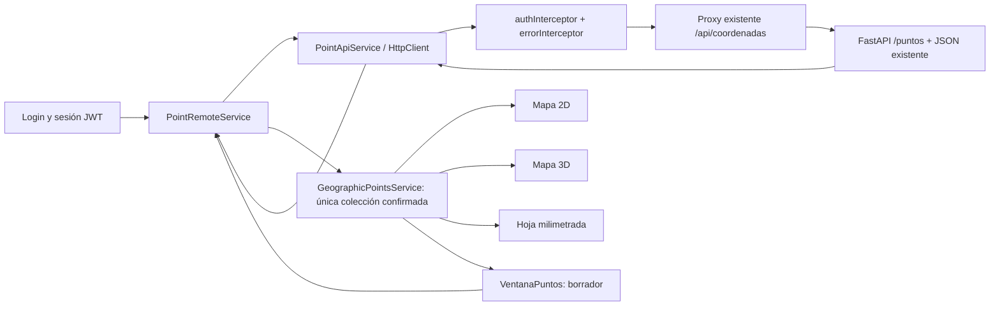

# Persistencia remota de PUNTOS

Fecha: 29 de octubre de 2026. Integración frontend con el router existente;
sin modificar Python, JWT, endpoints o archivos de datos del backend.

## Contrato comprobado en el código backend

`../back/coordenadas/puntos_geograficos.py` define `/puntos`; el router padre
`coordenadas.py` lo incluye bajo `/api/coordenadas`. Las cinco operaciones
exigen la dependencia `autorizar_administrador` del backend.

| Método | Ruta | Respuesta |
|---|---|---|
| GET | `/api/coordenadas/puntos` | 200 `{ok:true,total,registros:[...]}` |
| GET | `/api/coordenadas/puntos/{id}` | 200 `{ok:true,mensaje,registro}` |
| POST | `/api/coordenadas/puntos` | 201, mismo sobre individual |
| PUT | `/api/coordenadas/puntos/{id}` | 200, registro con UUID/creación conservados |
| DELETE | `/api/coordenadas/puntos/{id}` | 200, sobre con el registro eliminado; no 204 |

Entrada: nombre, observaciones opcionales, latitud, longitud, radio, relleno,
opacidad, linea, grosor, marcador y tamano. WGS84 es el sistema por defecto del
servidor. El cliente envía explícitamente solo campos editables: no ID, fechas,
geometrías de render o datos derivados. Nombre máximo 100 caracteres.

Salida: UUID, sistema_referencia WGS84, campos anteriores y fechas UTC
fecha_creacion/fecha_actualizacion. Observaciones null se adapta a texto vacío.
El radio máximo autoritativo depende de PUNTOS_RADIO_MAX_M en el servidor;
el formulario mantiene el límite existente de 100000 metros y los demás
límites visuales de estilo. Un rechazo del backend se presenta como 422.

## Arquitectura y flujo

Se conserva el servicio de estado actual, sin otra lista de negocio. El nuevo
coordinador conserva únicamente indicadores de operación y metadatos del
intento de creación incierto para comprobarlo, no otra colección de puntos.

`Vulcano` instancia el coordinador al entrar a la herramienta, antes de abrir
PUNTOS. Un effect observa la sesión y carga una vez por generación autenticada.
Abrir/cerrar ventanas no inicia GET adicionales. El botón RECARGAR LISTADO
permite actualizar o reintentar explícitamente una consulta fallida.

## Servicios e interfaces

- `PointInput`: solo campos editables. `GeographicRecord` conserva los UUID
  recibidos y puede contener las fechas del servidor.
- `PointApiService`: transporte de los cinco endpoints mediante HttpClient,
  timeout configurado, identificadores escapados y validación de respuestas.
  Verifica sobre ok, cantidad, UUIDs no duplicados, datos finitos, coordenadas,
  estilo, WGS84 y fechas válidas. No transforma una respuesta inválida en [].
- `PointRemoteService`: carga por sesión, serialización de operaciones,
  publicación de confirmaciones en el estado y errores controlados. POST/PUT
  no modifican la colección hasta recibir un registro válido. DELETE espera
  el sobre individual del servidor y luego retira solo ese ID.
- `GeographicPointsService.cargarConfirmados`: publica el listado validado y
  permite recuperarlo en cualquier vista, incluso inicializada posteriormente.
  Los registros recuperados quedan representados sin pedir una segunda
  confirmación GRAFICAR tras cada recarga.
- `confirmar`: inserta o actualiza por UUID sin mover los demás registros.
  Para puntos recién creados conserva el flujo previo del botón GRAFICAR;
  editar uno ya graficado actualiza sus capas derivadas.
- `limpiarSesion`: limpia solo memoria al terminar/cambiar sesión; nunca hace
  DELETE remoto. La API y el JSON permanecen intactos.

El método local `guardar()` del servicio de estado se mantiene por
compatibilidad y pruebas de representación. La ventana ya no lo usa para
persistir: **no hay fallback local que anuncie éxito cuando el servidor falla**.

## Autenticación y URL

`environment.shared.ts` declara `puntosGeograficosUrl='/api/coordenadas/puntos'`;
desarrollo y producción lo heredan. No hay direcciones localhost en componentes.
El proxy Angular existente remite `/api/coordenadas` a la aplicación principal
sin quitar el prefijo. No se modifica ese proxy.

ApiConfigService autoriza específicamente el router puntos y sus descendientes
del mismo origen, además del router de límites que ya existía. No autoriza
todo `/api/coordenadas` ni dominios externos. El HttpClient usa los interceptores
de appConfig, sin SKIP_AUTH y sin cabeceras Bearer manuales o logs de tokens.

401 conserva el comportamiento existente de cierre local de sesión; 403 no
lo cierra. Los registros en memoria y solicitudes de una sesión terminada no
pueden repoblar la siguiente: el coordinador registra limpieza con AuthService
y descarta respuestas de su época anterior. Esto puede vaciar la interfaz al
cerrarse sesión por 401, pero no borra el JSON del servidor.

Los tokens siguen solo en memoria y no se introduce refresh/persistencia JWT.
Después de F5 se necesita iniciar sesión de nuevo; entonces se recuperan los
puntos del servidor. La persistencia de puntos no cambia esa política de auth.

## Ventana y errores

`VentanaPuntos.agregar()` es ahora asíncrono: valida, espera POST o PUT y solo
entonces limpia nombre/observaciones y muestra PUNTO CONFIRMADO POR EL SERVIDOR.
`eliminar()` confirma con el usuario, espera DELETE y solo después retira la
fila/capas. Cerrar la ventana mientras una operación termina no permite que el
callback viejo borre el nuevo formulario de otra instancia.

Se muestran Cargando puntos, Guardando, Actualizando, Eliminando, error y
ausencia de registros. El fieldset y botones se bloquean durante peticiones;
una segunda llamada programática también se rechaza. El formulario se distingue
como borrador, y el listado contiene solo confirmaciones.

| Estado | Tratamiento |
|---|---|
| Conexión/timeout | Mensaje y reintento manual; no borra borrador ni anuncia guardado |
| 401 | Mensaje de autenticación; cierre local existente de la sesión |
| 403 | Permisos insuficientes; conserva sesión y datos confirmados |
| 404 | Registro inexistente; solicitar recarga |
| 409 | Conflicto o persistencia ocupada; recargar antes de reintentar |
| 422 | Datos rechazados; conserva borrador para corregir |
| 500/otros 5xx | Error servidor; conserva datos y aplica política de creación incierta |
| Respuesta inválida | No publica registros parciales ni sustituye un listado válido |

## Reintentos sin duplicación

Se bloquean los dobles clics y no hay retry automático de mutaciones.
Un POST puede haberse confirmado en el servidor aunque se pierda su respuesta.
El router actual no implementa Idempotency-Key, UUID de cliente ni consulta por
identificador de intento. Por eso un reenvío ciego no puede ofrecer garantía de
exactamente una creación.

Ante conexión/timeout/5xx o confirmación ilegible, el coordinador conserva el
payload normalizado y los IDs conocidos antes del intento. Bloquea nuevos
guardados y ofrece COMPROBAR REGISTRO: realiza únicamente GET y busca un UUID
nuevo que coincida exactamente con los campos del intento. Con una coincidencia
recupera la confirmación sin POST adicional. No modifica campos geográficos.

Si no hay una única coincidencia, conserva el bloqueo y permite volver a
consultar. No supone que una lista vacía pruebe que una escritura pendiente
falló: podría continuar ejecutándose en el servidor. Ese caso requiere revisión
del backend o soporte de idempotencia para permitir reenvío seguro. La búsqueda
por contenido no es un ID de transacción y tiene límites ante concurrencia con
payloads idénticos. No se inventa soporte de backend ni se oculta esa limitación.

PUT mantiene UUID; DELETE solo aplica al ID solicitado. Un error mantiene la
fila hasta confirmación o recarga autoritativa. El 409 actual procede del
bloqueo de persistencia, no de un mecanismo ETag/If-Match que el router no tiene.

## Archivos modificados

- `shared/geographic-points/point-api.service.ts`: interfaces DTO, transporte y validación.
- `shared/geographic-points/point-remote.service.ts`: coordinación de sesión y HTTP.
- `shared/geographic-points/geographic-points.ts`: publicación de registros confirmados.
- `ventana-puntos.ts/html/css`: espera remota, mensajes, bloqueo y reconciliación.
- `vulcano.ts`: inicialización independiente de la ventana.
- `environment.shared.ts`, `api-config.service.ts`: URL y frontera Bearer acotada.
- `point-remote.spec.ts`: pruebas HTTP con interceptores reales y backend simulado.
- Specs de ventana/hoja: esperan operaciones asíncronas; usan un fixture local
  exclusivamente para aislar transporte en pruebas de dibujo.
- `vulcano.spec.ts`: provider de Router necesario para el coordinador autenticado.

Las capas cartográficas y fórmulas no se modifican: consumen los mismos signals.

## Pruebas realizadas

**84 pruebas aprobadas en nueve suites** de autenticación, REST, representación,
ventana y hoja. Todas las peticiones de estas pruebas son HttpTestingController,
sin escrituras reales ni reinicios de procesos del backend.

Se verifican GET automático tras login sin abrir ventana, ausencia de GET al
reabrir, UUID/fechas conservados, POST→consulta→PUT→DELETE confirmados, doble
clic, respuesta inválida, 401/403/404/409/422/500/conexión, borrador conservado,
respuesta tardía de sesión anterior descartada y recuperación tras recrear el
inyector frontend y autenticarse de nuevo. La creación ambigua se reconcilia
por GET y no repite POST; una consulta sin coincidencia mantiene el bloqueo.
Las pruebas de hoja, círculos métricos, capas Leaflet/MapLibre y controles de
ventana pasan con el transporte aislado donde corresponde.

Compilación de desarrollo correcta; persiste el aviso previo NG8113.

## Comprobaciones manuales pendientes

1. Login real, crear/consultar/editar/eliminar un punto de prueba autorizado y
   verificar que el JSON remoto refleja el resultado.
2. F5 y reinicio real del frontend: volver a iniciar sesión y comprobar UUIDs,
   listado y las tres vistas. La recreación está probada de forma simulada,
   no mediante el navegador del usuario.
3. Reinicio real de FastAPI con su JSON conservado y nueva consulta: no se
   reinició ni modificó el backend en esta tarea. La durabilidad depende de
   mantener DATA_FILE/volumen del servidor.
4. Publicación de producción: la plantilla Nginx revisada anteriormente no
   publicaba `/api/coordenadas` directamente. Verificar una regla acotada para
   puntos y su upstream en el despliegue antes de publicarlo; no se adivina ni
   cambia aquí el destino de otros microservicios.
5. Revisión visual con WebGL/DEM reales. No se afirma validación end-to-end
   sobre los datos o credenciales privados del usuario.
