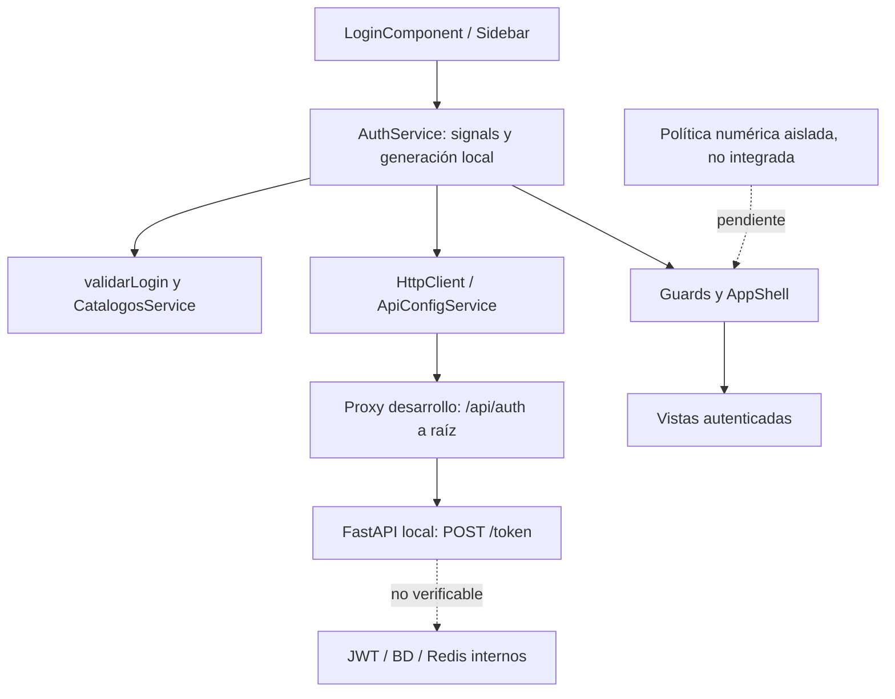
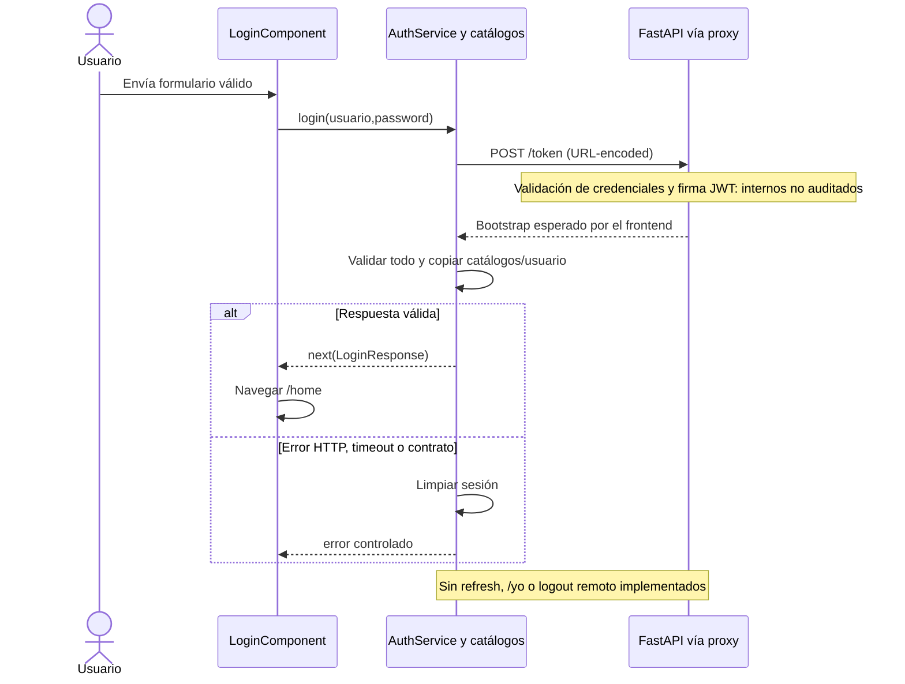

# Arquitectura de autenticación — VULCANO

Fecha de corte: 27/10/2026. Versión documental 1.0. Revisión del árbol de trabajo, no certificación de producción.

## Estado comprobado

Angular standalone y signals centralizan la sesión en AuthService. LoginComponent envía username/password URL-encoded a /api/auth/token; proxy.conf.cjs elimina /api/auth y llama /token en el backend local. validarLogin valida usuario, tokens y cinco catálogos; CatalogosService copia los catálogos antes de publicar acceso. La expiración usa Date.now()+expira_en*1000. Access y refresh solo permanecen en memoria. Recargar requiere login; no hay /yo, refresh ni revocación remota implementados.

El login omite authInterceptor y errorInterceptor mediante HttpContext; el componente muestra errores controlados. La cadena global está registrada como loader → auth → error. El interceptor auth limita Bearer a bases configuradas, usa cache:no-store y descarta éxitos de sesiones previas. El interceptor error cierra localmente ante 401 protegido actual; 403 conserva sesión. Logout limpia estado, claves propias, cookies visibles conocidas y callbacks privados; no borra cookies HttpOnly del servidor ni revoca remotamente.

## Diagrama de arquitectura

## Diagrama de secuencia

## Autorización: dos estados distintos

AuthService opera con usuario.permisos:string[] y comparación exacta; no hay excepción activa de administrador. Sidebar utiliza booleanos estáticos y authGuard solo autentica. authorization-policy.ts implementa en aislamiento ADMINISTRADOR vacío=total, administrador con lista=limitado y USUARIO vacío=denegado. No conecta los IDs a funciones reales ni decodifica JWT. No existe JwtPayload activo ni lectura de sub/rol/permisos/exp/iat/jti desde un token. Estos claims son requisitos del contrato v1, aún no evidencia de su contenido real. La validación criptográfica y autorización definitiva pertenecen al backend.

## Sesión y persistencia

La ventana de 25 minutos de access y 60 minutos de inactividad, rotación de refresh, rechazo de renovación concurrente y actividad humana son requisitos pendientes. El código acepta expira_en positivo del bootstrap; no fija 25 minutos para el backend. Redis, base de datos de identidades, lista de revocación, fuerza bruta e IPs no están comprobados con código backend. La única evidencia consultada del servidor es OpenAPI, sin autenticarse; su respuesta 200 de /token no describe un esquema estricto. No se ejecutaron operaciones remotas de seguridad.

## Contratos y próximos pasos

Obtener OpenAPI v1, ejemplo anónimo de payload/bootstrap y seed de permisos. Confirmar métodos/cuerpos/respuestas, expiración, transporte del refresh y persistencia antes de integrar. Conectar permisos a guard, menú y acción; implementar refresh compartido con un solo reintento y actividad humana eficiente; añadir revocación confirmada, /yo y módulo administrador. Mantener catálogos fuera del JWT y reutilizar CatalogosService.
